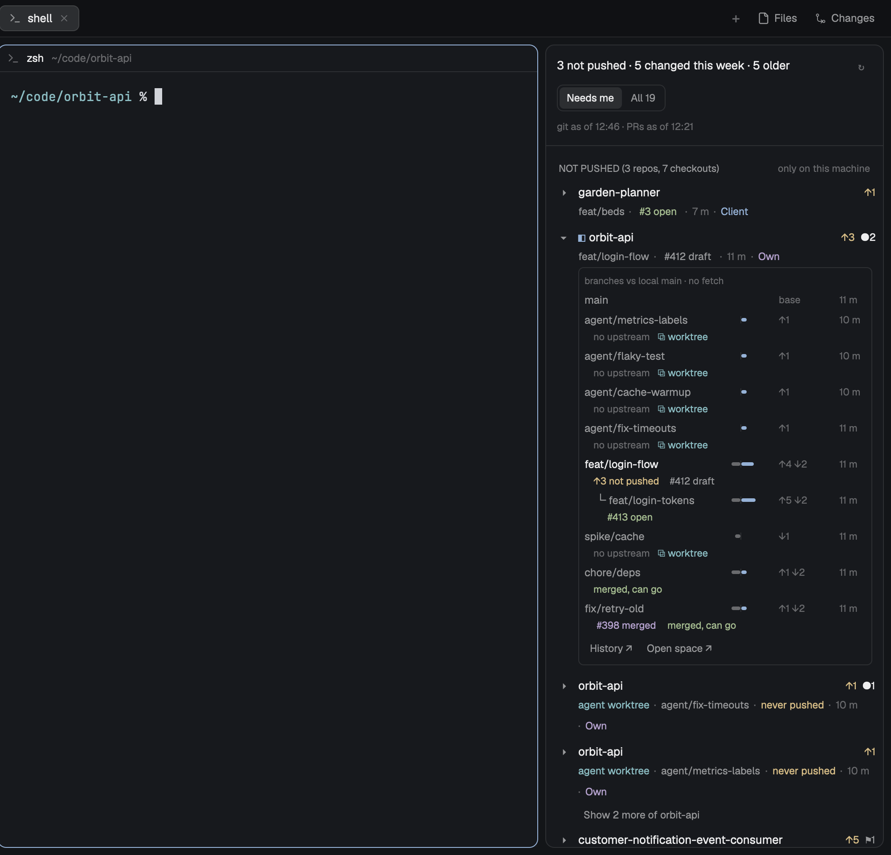
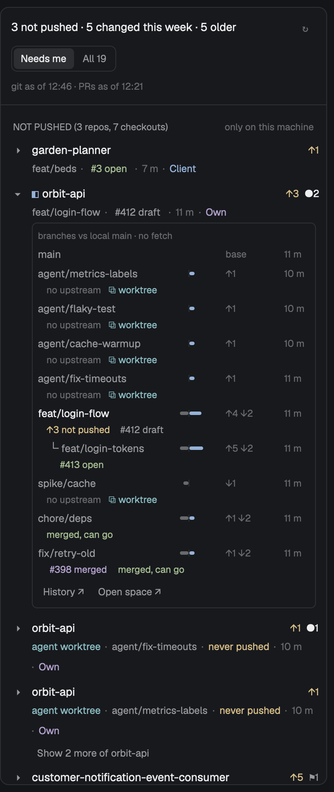
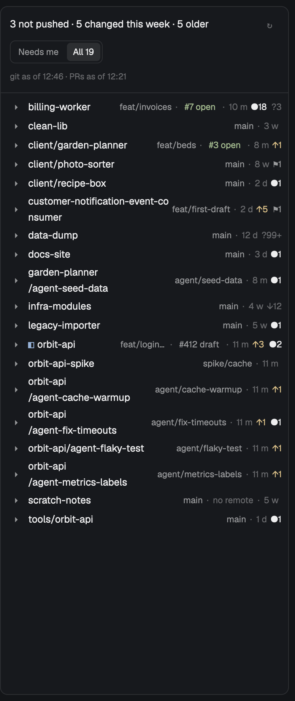
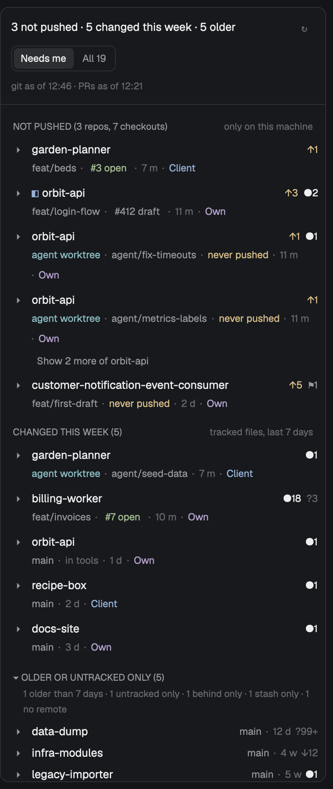
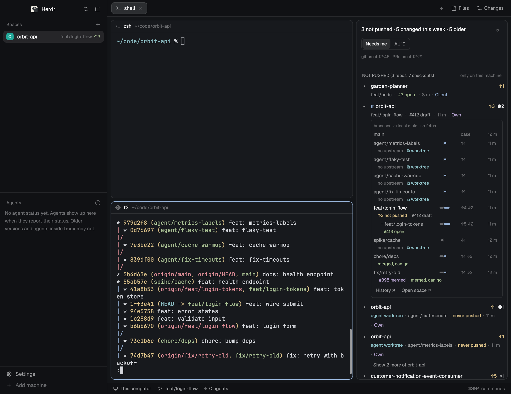

# Corgi · Worktrees for Herdr

<h3 align="center">See which of your git checkouts hold work that exists only on this machine: commits that were never pushed, changes you started this week, and what has been lying around for longer.</h3>

<p align="center"></p>

<p align="center"><sub>✓&nbsp;Free,&nbsp;MIT &nbsp;·&nbsp; ✓&nbsp;Runs&nbsp;locally,&nbsp;never&nbsp;fetches &nbsp;·&nbsp; ✓&nbsp;herdr-app&nbsp;0.1.15+</sub></p>

Part of [Corgi](https://github.com/saefty/herdr-corgi), a set of Herdr mods that plug into each other.

A side panel for Herdr over every git checkout under your code folders, including the worktrees agents work in.
It reads git on your disk and nothing else: it never fetches, and it never writes to a repo.

## Use cases

- **Before you close the laptop.** "Not pushed" lists every repo with commits that are only here, the newest
  first, with the branch and how many commits. A branch that was never pushed counts too.
- **An agent finished in a worktree.** Agents' worktrees are listed with the repo they belong to, so the three
  commits on `agent/fix-timeouts` don't stay behind when you remove the worktree.
- **Where was I this week?** "Changed this week" has the checkouts with uncommitted changes to tracked files from
  the last seven days. Old leftovers and folders full of untracked files are folded away below, with a count and
  the reason.
- **What can go?** Open a row and its branch card shows every local branch against main: ahead, behind, its age,
  its worktree, its pull request. "merged, can go" appears only with proof.
- **Go there.** A click on a row goes to the space that is open on that checkout, or opens one.

## Screenshots











## Features

- Three lists: **Not pushed** (commits only on this machine), **Changed this week** (tracked files touched in the
  last 7 days), **Older or untracked only** (folded: older changes, only untracked files, only behind, only a
  stash, no remote at all). One sentence at the top says how many of each.
- Rows keep the repo's name whole and say the branch, the pull request, the age and, with contexts, the context.
  Marks: `↑3` commits not pushed, `↓2` to pull (as of the last fetch), `●4` changed tracked files, `?7`
  untracked, `⚑1` stash entries, `◧` a space is open there.
- A repo and its worktrees count as one repo; a repo with many unpushed worktrees shows its newest and one line
  for the rest.
- The branch card (▸ on a row): one `git for-each-ref` for that repo only. Branches stacked on each other are
  indented. "History ↗" opens `git log --graph` in a pane, "Open space ↗" goes there.
- "All" lists every checkout by folder, clean ones included.
- Cheap by design: one `git status` per checkout in a pass, one `stat` for all file times, a watch on each
  `.git` so commits and pushes show without a pass. Full passes run only while the panel is shown.
- Other mods can add pull request marks, split the list by context (work and personal, say), read the number of
  repos that are not pushed for a button, and find the listed checkouts in Go to. Without any of them the panel
  works on its own.

## Works with

Worktrees, [Go to](https://github.com/saefty/herdr-corgi-goto) and [PR review](https://github.com/saefty/herdr-corgi-pr-review) each work alone. Installed together, they plug into each other:

- With **Go to**, the checkouts that need a look show up there ("orbit-api · feat/login-flow, 3 not pushed") and
  Enter takes you to the space.
- With **PR review**, a click on a pull request mark opens that PR in the review. The marks themselves come from a
  provider: any mod that knows your pull requests can publish them.
- **Your own mod** can publish pull requests, tell which checkout belongs to which of your setups, and show the
  count in a bar. [PROVIDERS.md](mods/worktrees/PROVIDERS.md) has the shapes.

## What's in here

- `mods/worktrees/`: the mod. `main.js` is the view, `model.js` and `status.js` are the logic without any UI.
- `RECIPE.md`: the brief to build it from scratch.
- `demo/`: an invented setup for the screenshots.

## Requirements

A mod can't install programs. Everything the panel runs is on a developer machine already:

| Program | Needed for | macOS | Linux |
|---|---|---|---|
| `git` | everything: status, branches, the history pane | `brew install git` (or Xcode's) | `sudo apt install git` |
| `git` 2.41 or newer (optional) | the bars in the branch card (ahead of and behind main); an older git lists the branches without them | `brew upgrade git` | your distribution's newer package |
| `find`, `stat` | finding checkouts, file times for "this week" | part of macOS | part of coreutils and findutils |
| `less` (optional) | "History ↗": git's pager keeps the pane open; without it the pane closes at once | part of macOS | `sudo apt install less` |

It needs no network, no `gh` and no login. Pull request marks come from other mods, not from a program here.
The demo scripts (`demo/`) also use `node` and `ffmpeg`; the mod doesn't.

## Install in three steps

<table>
<tr>
<td align="center" valign="top" width="33%"><h3>1</h3><b>Add the mod</b><br /><sub>With <a href="https://github.com/saefty/herdr-corgi">Corgi</a>: <code>corgi enable worktrees</code>. By hand: copy <code>mods/worktrees</code> to <code>~/.config/herdr-app/mods/</code>. There are no keys to merge.</sub></td>
<td align="center" valign="top" width="33%"><h3>2</h3><b>Say where your code is</b><br /><sub>It looks in <code>~/code</code>, <code>~/src</code>, <code>~/projects</code> and <code>~/dev</code>. Other folders: <code>roots</code> in <code>worktrees.config.json</code> (below).</sub></td>
<td align="center" valign="top" width="33%"><h3>3</h3><b>Open it</b><br /><sub><code>herdr-app do mod.open --name worktrees</code> opens it as a window. To dock it, add a block to a layout of yours (below).</sub></td>
</tr>
</table>

Or tell your agent: `Read ~/.config/herdr-app/AGENTS.md, then add this mod: https://github.com/saefty/herdr-corgi-worktrees/tree/main`

By hand, step by step: copy `mods/worktrees` to `~/.config/herdr-app/mods/`, then run
`herdr-app check ~/.config/herdr-app/mods/worktrees`. The mod docks nowhere by itself.

**As a window:** bind a free key of yours to `mod.open:worktrees` in `~/.config/herdr-app/keys.json`. The same key
closes it. This repo ships no key, so nothing of yours is rebound. Use the window or a docked block, not both:
each copy checks the repos on its own.

**Docked:** add `{ "id": "worktrees", "type": "block", "content": { "mod": "worktrees" } }` to a layout you own.
In a copy of Herdr's main layout (`herdr-app do layout.clone '{"name":"main","as":"mine"}'`) the right column's
stack `panel-body` is the place: add the block to its `children`, then show it with
`herdr-app do layout.select --stack panel-body --child worktrees` and `herdr-app do layout.show --id panel`.
The panel is made for 380 px and works from about 280 px.

## Settings

`~/.config/herdr-app/worktrees.config.json` (optional; these are the defaults):

```json
{
  "roots": ["~/code", "~/src", "~/projects", "~/dev"],
  "worktreeRoots": ["~/.herdr/worktrees"],
  "prune": ["node_modules", "build", "dist", "target", ".venv", ".terraform"],
  "depth": 4,
  "max": 500,
  "weekDays": 7,
  "goto": true
}
```

`roots` are the folders searched for git checkouts and `depth` how deep. `worktreeRoots` are folders whose
checkouts are marked "agent worktree" (the default is where Herdr puts them). `prune` are folder names never
entered. `max` caps the list, `weekDays` is what "this week" means, and `goto: false` keeps the checkouts out of
Go to. After a change press ↻ in the panel.

## Customize

Without touching code:

- **Where it looks:** `roots`, `depth` and `prune` in `worktrees.config.json`.
- **What "this week" means:** `weekDays`.
- **Keys:** every click has a command (`worktrees.refresh`, `worktrees.show:all`, `worktrees.expand:<repo>`, …);
  the list is in [PROVIDERS.md](mods/worktrees/PROVIDERS.md#4-commands).

Changed the code itself? Your edits survive `corgi update`: Corgi merges your version, the old release and the new
one. `corgi diff worktrees` shows what you changed.

## What it does not do

- It never runs `git fetch`. "Behind" and a gone upstream are as fresh as your last fetch, and the panel says so.
- It never writes: no push, commit, stash or branch delete. You act in the repo's space.
- "Not pushed" looks at the branch each checkout has checked out. Other branches with local commits show in the
  branch card.
- The count for a bar is live only after the panel was shown once since the app started.

## Tests

`node --test mods/worktrees/test_model.mjs`

## For mod authors

How to publish pull requests, contexts and read the count from your own mod: [PROVIDERS.md](mods/worktrees/PROVIDERS.md).

## License

MIT
