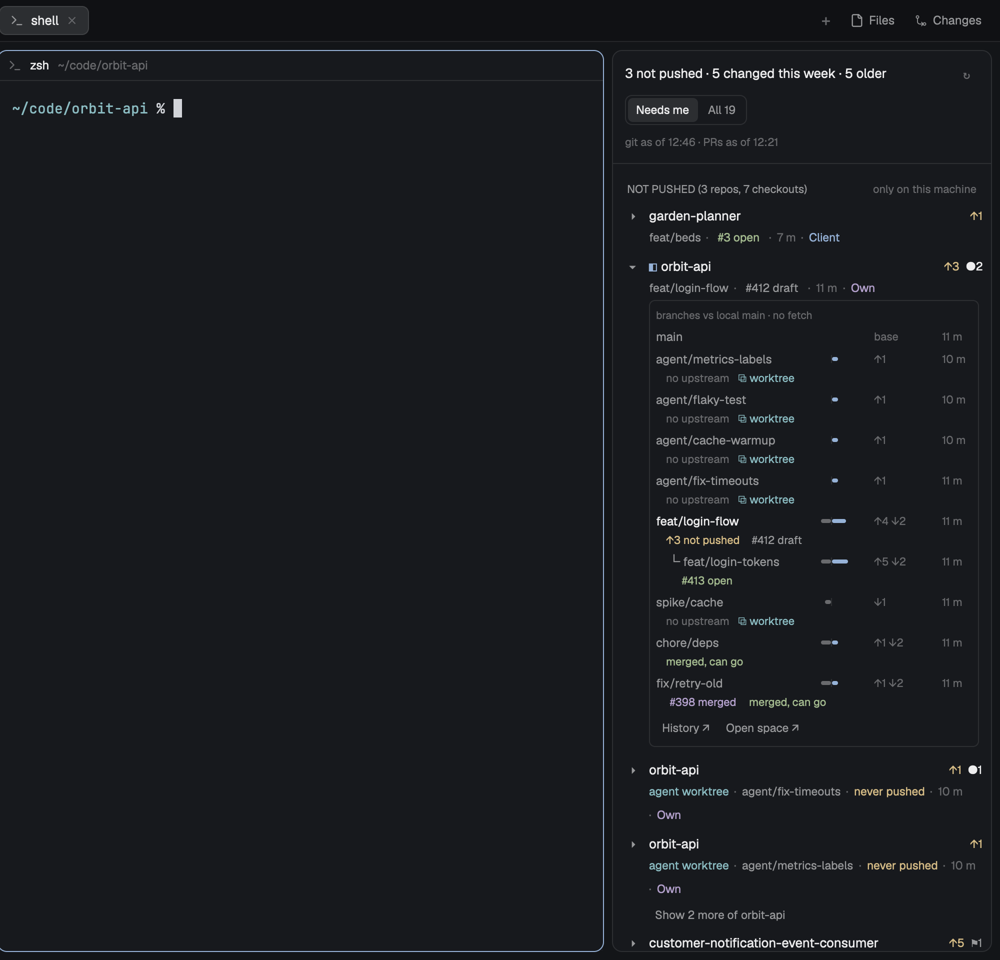

# Corgi · Worktrees

See which of your git checkouts hold work that exists only on this machine, and read a repo's history as a drawn tree: branches as colored lanes, long names kept readable, merged history folded away.

A side panel over every git checkout under the person's code folders and the worktrees agents work in. It answers
one question when it opens: where is work that I could lose or forget? It reads git on disk only, never fetches,
never writes to a repo.

**What you see:** a panel made for a 380 px column, with a 10 px radius and a 1 px border. The header (12 px
padding) has one sentence in 13 px semibold ("3 not pushed · 4 changed this week · 5 older") with a 24 px ↻ on the
right, a two-part switch "Needs me | All 20" (24 px high), and a dim 11 px line "git as of 10:29 · PRs as of
10:05" (without PR marks: "as of 10:29 · local, no fetch"). Below it the list scrolls. "Needs me" has three
groups with 11 px semibold heads: `NOT PUSHED (3 repos, 9 checkouts)` with "only on this machine" on the right,
`CHANGED THIS WEEK (4)` with "tracked files, last 7 days", and the folded `▸ OLDER OR UNTRACKED ONLY (5)` with its
reasons on a second line ("1 older than 7 days · 1 untracked only · 1 behind only · 1 stash only · 1 no remote").
A row has two lines: a 24 px ▸, `◧` in the accent color when a space is open there, the name in 13 px (never cut,
it wraps), and on the right the marks in 11.5 px: `↑3` in `ansi3` semibold (not pushed), `↓2` dim (to pull),
`●4` (changed tracked files), `?7` dim (untracked), `⚑1` muted (stash). The second line, indented 28 px, has
`agent worktree` or `worktree` in `ansi6`, the branch, `never pushed` in `ansi3`, `no remote`, the PR mark
(`#412 draft`: open `ansi2`, draft muted, merged `ansi5`, closed dim), the folder when two repos share a name,
the age ("5 m", "2 h", "3 d", "5 w") and the context's label in its color. Facts are separated by a dim `·` and
wrap. Rows in the folded group and under "All" are one line: name, then branch · PR · age in a slot of at most
170 px, then the marks. Narrower than 300 px of content, age, context and the group hints are left out; the
branch stays.

**How it behaves:**
- Scan: one `find` per root (`-maxdepth depth`, hidden and pruned folders skipped, stops at each `.git`), every
  30 minutes and on ↻. Per checkout two small files are read: `.git` when it is a file (a worktree: its git
  folder, and the repo it belongs to) and the config (is there a remote, origin's URL, owner/name on github.com).
- A check, in two steps, because a process start is the expensive part. First `python3 probe.py <path> <gitdir>
  <common> …`, one process for many checkouts (up to 4 side by side for 160 and more, so the list fills in parts).
  It reads HEAD, the refs and packed-refs, the config (upstream), the stash log, parses the index and `lstat`s the
  tracked files, their folders and the folders right below those. Per checkout it prints a JSON line: branch,
  commit, upstream commit, whether the commit is a remote branch's, stash count, the times (`logs/HEAD`, index,
  newest changed tracked file, `FETCH_HEAD`) and a fingerprint of all of it. Of the index the fingerprint takes
  what is staged (paths, modes, blobs, flags), not the file's time: other tools' `git status` rewrites the index
  every few seconds in a repo someone works in. Second, only for checkouts whose
  fingerprint differs from the one stored with their last git status (or that have none, or with Shift-↻ for all):
  `git --no-optional-locks -c core.fsmonitor=false status --porcelain=v2 --branch --show-stash -z`, 8 at a time.
  For a branch without upstream whose commit is on no remote ref: `git rev-list --count HEAD --not --remotes`,
  once per HEAD and state of the remote refs. Without python3: git for every checkout and one `stat` for the times.
- What is known (status, times, fingerprint per checkout) is kept in `localStorage` and shown at once on the next
  start; rows update as their answers come in, and the header says "checking 8/21 …" meanwhile.
- When: all checkouts at start, on ↻ and when the panel comes back on screen after more than a minute. Every 5
  minutes while it is on screen only the checkouts in use: a space's folder or a terminal inside, or touched in the
  last day (a check after a `.git` change does not put this off). A watch on the `.git` of the repos in use (32 at most; hidden: only
  the ones with a space) flags that checkout
  (and the worktrees its changed paths belong to); flags are collected for 1.5 s and checked together, or for a
  minute when only index files moved (staging, or another tool's `git status`). One check runs at a time. The header says "git as of 13:40
  (all 13:05)" when the last check of everything is older.
- Groups: not pushed = ahead of upstream, or never pushed with commits on no remote. This week = tracked changes
  whose newest changed file is at most `weekDays` old (the index time only when no changed file is left). Older =
  the rest that is not clean, with the reason. A repo without any remote is "no remote", not "not pushed". A
  worktree's stash is its repo's and shows there only.
- Order: by age, newest first. In "Not pushed" a repo and its worktrees stay together, the repo first; more than
  3 checkouts of one repo fold into "Show n more of <repo>". "Changed this week" shows 8, then "Show n more".
- A row's click goes to the space on that checkout (its folder or a terminal of it is inside), else `space.new`
  there. ▸ opens the branch card.
- The branch card: `git for-each-ref refs/heads` with upstream, track, worktree path, date, HEAD and
  `%(ahead-behind:<base>)`. The base is origin's default branch (from `refs/remotes/origin/HEAD`), else `main`,
  `master`, each local first, then `origin/…`; without one, or with a git older than 2.41, rows have no bars. A
  row: name (the checked-out one semibold), a two-sided bar on a log scale (behind left in dim, ahead right in
  accent), `↑4 ↓2`, the age; under it `↑3 not pushed`, `no upstream`, `↓2 to pull`, the PR mark, `⧉ worktree`,
  `merged, can go`. A branch whose PR targets another local branch is indented under it. At most 30 rows.
  Below: "History ↗" (`pane.split` down with `git log --graph --oneline --decorate --all`, pager
  `less -+F -R`) and "Open space ↗".
- `merged, can go` only when the branch's PR is merged and its head is still the branch's commit, or git reports
  the upstream as gone.
- Contexts, PR marks, the published count and the Go to rows: PROVIDERS.md.

**The history view** (the same mod, opened with props `{history: <checkout path>, name, branch, slug, context}`;
"History ↗" does `tab.new {name: "History · <repo>", mod, props}`, or a window when no space is shown; when a tab
of that name with this mod in it exists in any space, it selects that space and tab instead and sends
`h-pick:<branch>`):
- Header: the repo's name, a three-part switch "Branches | This branch · <name> | All commits", a filter field, "Load
  more" while git has more, ↻, and a dim line "as of 13:21 · 50 commits · base main · no fetch". Narrower than
  560 px the filter moves to a line of its own.
- Data: `git for-each-ref refs/heads` (upstream, track, worktree, HEAD) and one
  `git log --topo-order --decorate=full -z --format=%H%x1f%P%x1f%D%x1f%s%x1f%an%x1f%at -n 401`. Branches: `--branches
  HEAD <base>`; This branch: `<branch> <base>`; All: `--exclude=refs/stash --all HEAD`. The base is origin's default
  branch as a local branch, else `main` or `master`, else `origin/<default>`.
- What is shown (`graph.js shown`): commits the base does not reach, commits with a branch, tag or HEAD, the commit
  an unmerged branch forks from, and the base's tip. The rest is folded: each connected stretch of three or more
  hidden commits becomes one row "· 14 commits ·" (`plan`), which a click lists. "All commits" folds nothing. A
  filter shows only commits whose subject or ref names contain it and folds everything between.
- Lanes (`graph.js lanes`): rows top to bottom. A row takes the lane that waits for it, else the leftmost free one;
  its first parent goes straight down, further parents bend to the lane that already draws towards them or to a new
  one; lanes waiting for the same commit meet there. The base's tip has lane 0 reserved, so the main line is the
  left lane. A lane that ended is used again. Colors: every local branch gets one of six (`ansi1` … `ansi6`) by its
  name, in name order, the least used one when its own is taken (`palette`); the base's lane is `muted`.
- Lanes fit themselves (`graph.js laneFit`): 14 px apart (10 px narrow) while that takes no more room than ten
  (eight) such lanes, then closer, down to 8 px (7 px); at most 16 lanes are drawn at once, and with more the
  header shows "lanes 1–16 of 23 ◂ ▸" and the lane area rolls by eight. A bend to a lane outside that window is
  drawn once per side and cut off at the edge.
- A row is 26 px high. Lines are 2 px (3 px for HEAD's, the picked and the shown
  space's branch), bends are a box with two borders and one round corner of 8 px. Dots: 8 px filled; a merge 9 px
  hollow; HEAD 12 px with a foreground ring; a fold a 6 × 12 px outline. Then the chips, 18 px high, in the
  terminal font at 11 px: a branch with a 1 px border in its lane's color (`● ` when checked out, ` ⇄ origin`, ` ↑2`
  not pushed, ` ⧉` in another worktree), the PR mark, a remote branch dim, a tag `◆ v1.1` on `surface`. At most 3
  chips (2 narrow), then `+n`. Names longer than about 30 % of the width lose their middle (`middle`). Then the
  subject in 12.5 px, its Conventional Commit lead tinted (feat `ansi2`, fix `ansi1`, docs `ansi4`, perf `ansi5`,
  refactor `ansi6`, test `ansi3`, others dim), merged history in `muted`; then the 7-character hash, the author's
  initials and the age, as one right-aligned monospace cell. Narrow: only the age.
- What a row draws is prepared when the rows, the width, the picked branch, the PR data or the lane window change
  (`prepare`: `graph.js shapes` gives the lane pieces, `placeChips` the chips' places): the list's renderer only
  turns those numbers into elements, at most `rowElements(...)` of them (14 for an ordinary row, 27 with 16 lanes).
- The rows are a `v_virtual_list`; a scrollbar is paired by name. A click selects the row and shows the details
  under the list: the full subject, hash · author · date, up to 6 lines of the message, up to 10 files as
  `+3 −1 path` from `git show --numstat`, "Open diff ↗" (`pane.split` down with `git show`) and ✕. A click on a
  branch chip goes to the space on the folder where that branch is checked out (else this checkout), on a PR mark
  to the PR, on a fold opens it.
- Keys (the mod is `focusable`): up and down move the selection (and the open details with it), Enter picks, Esc
  closes the details, then clears the filter, then the selection.

**Built from:** `mods/worktrees/main.js` (the panel, the scan, the checks, the watches), `probe.py` (which
checkouts changed, from files; standard library only), `history.js` (the history
view), `hub.js` (what both share: PR providers, running a click's commands, spaces), `model.js` (pure: settings,
git folders, contexts, groups, ages, PR index, the branch card, what Go to gets), `graph.js` (pure: the log parser,
what to show, folds, lanes, colors, name shortening), `status.js` (pure: the porcelain v2 parser), `name.js` (the
mod's name in one place), `mod.json` (`place: none`, `focusable`, and an overlay so `mod.open` shows the panel as a
window). It uses `exec` for `find`, `python3`, `git` and (without python3) `stat`, `readTextFile` for `.git` files,
`watchFolder`, `spaces() panes() layout()`, `nextCommand()`, and `localStorage` for the list of checkouts and the
last pass. Settings: `worktrees.config.json` in the app home, and from Herdr's own `settings.json` there the
folder New worktree creates checkouts in (`worktrees.directory`, else `~/.herdr/worktrees`): one more worktree root.

**Watch out:**
- Measure what a process start costs before choosing a design: here it was 0.25 s for any program, so 300
  checkouts times one `git status` took 90 s at 5 s of CPU, and bundling them into one `sh -c` changed nothing.
  The fix is fewer processes, not fewer `exec` calls.
- The probe must never answer wrongly: whatever it cannot read (reftable, an index version it does not know, a
  truncated file) gives no fingerprint, and git is asked.
- `cx.notify()` during `render` throws, and a `cx.spawn` started in `render` runs at once. Start a pass from
  `render` through `cx.timer.after(0, …)`.
- `render` is not called while the block is hidden. A 10 s timer notes "hidden", and the next render re-checks.
- A copy starts the first time its block is shown: the count is published only after that.
- `runs += await …` in parallel workers loses updates; add after the await.
- Other tools' `git status` rewrites the index, so the index time says nothing about your changes. Ask the
  changed files.
- A worktree's git folder lies inside its repo's `.git`: one watch per repo covers its worktrees, and the changed
  paths say which checkout to re-check.
- Herdr watches at most 64 folders for all mods together ("already watching 64 folders"). A watch per repo
  starves the other mods: watch at most 32, the repos in use first (`model.js watchPlan`). Keep the promise
  `watchFolder` returns and call its `cancel()` when the repo is no longer in use or the panel is hidden; a loop
  that only stops at the next change holds the folder until then, for a removed checkout forever.
- A watch tells nothing about the time before it started, and Herdr may drop one nobody waits on: read the repo
  once right after `watchFolder` was called for it. An empty batch that was not your cancel means the watch ended:
  do not call again in a loop, start it with the next plan.
- A stash belongs to the repo: every worktree reports it.
- BSD `stat -f '%m %N'` and GNU `stat -c '%Y %n'` differ; try one, then the other.
- Never judge "merged" by ancestry: a squash merge leaves the branch unmerged.
- Rows of a virtual list cannot register handlers (`on_click` throws there). The list has one `on_item_click`; to
  tell which chip was hit, the area notes the press's x and the chips have widths worked out from their text
  (monospace font), so the same numbers draw and hit-test (`placeChips`, `hitChip`, tested at three zooms).
- `on_size_change` reports window px: sizes times the app's zoom (`settings().zoom`). Divide by it before
  comparing with the mod's own px, or a threshold like "narrower than 560" moves with the zoom. A press's x is
  made zoom-free by its ratio to the element's bounds (`pressX`).
- A renderer that builds too much is cut off under load ("virtual list item renderer: interrupted"): count the
  elements a row costs and keep a test on it.
- Work out rows and lanes when the data, the view, the filter or a fold changes, never in `render`: a script
  slice is cut off after about 50 ms. 400 commits take about 2 ms here.
- A view property must not share its name with a method (`this.history` and `history()`): the method wins.
- Fold only connected stretches: two hidden commits next to each other in the list may belong to branches that
  have nothing to do with each other, and one fold for both would draw a knot that is not there.
- A mod's commands need a copy on screen, and a covered window draws nothing: scripts nudge the window first.

**Open in your editor.** `editor.js` (pure, tested, the same file as in the PR review mod) has the editors, how the
installed ones are found by reading files (macOS: `Contents/Info.plist` of each app in `/Applications` and
`~/Applications`; Linux: the command line tools in the usual folders), which editor a place gets (a pick for the
repo, else a file by its ending, a folder by `pom.xml`, `build.gradle`, `build.gradle.kts` or `.idea/`, a linked
worktree VS Code), and the ONE program a click starts (macOS: `open` with the editor's link for a file and
`open -a <app> <folder>` for a folder). `editor-view.js` is the Herdr side: the answer about installed editors is
kept for a day in localStorage, a folder's facts (`.git`, the project's marks) are read once as files, a link says
"Opening …" for three seconds and takes no second click meanwhile, only a failure is a toast, and a pick in the ▾
menu is written to shared `editor.choice` (keyed by the repo's shared `.git` folder, `main` and `worktree` apart)
only when it changed. Places: a row (the monogram only on the row the pointer is on, in a reserved width; a right
click opens the menu), the branch card's foot, a card row whose branch is checked out in another folder, the
history view's head, and a commit's files when the commit is on the checked-out branch and the file exists. The
menu is the mod's own copy in a popup (`props.menu`); its entries are commands the opening copy takes.
- A command may name a folder no link has shown yet: wait for the folder's facts before choosing the editor, or a
  Gradle project opens in the wrong one.
- In the demo `open` is a script first on the PATH that writes its arguments to `demo/run/opened.txt`, and both
  editors are empty app folders in the stand-in home: no editor is ever started. That only holds because the demo
  window runs with a home of its own: with your real home Herdr's `exec` takes your login shell's PATH, and a test
  window reached the real `open` here. For such a window set `"dryRun": true` in the settings or put a file
  `editor.dry-run` into its Herdr home; a click waits for the settings and starts nothing.

**Done when:** `herdr-app check mods/worktrees` passes, `node --test mods/worktrees/test_model.mjs
mods/worktrees/test_graph.mjs` passes, "History ↗" on `atlas-platform` in the demo shows main as the left lane
with six branches beside it and folds like "· 9 commits ·", and
`python3 mods/worktrees/test_probe.py` passes, in the demo the panel says "4 not pushed · 5 changed this week · 5
older", ↻ with nothing changed starts one process (the ↻ tooltip says so), a commit in a repo changes the sentence
without ↻, and `worktrees.expand:orbit-api` shows the
stack `feat/login-flow` → `feat/login-tokens` and "merged, can go" at `fix/retry-old` and `chore/deps`,
`node --test mods/worktrees/test_editor.mjs` passes, and in the demo `worktrees.editor:<orbit-api's folder>` writes
`open -a …/IntelliJ IDEA.app …/orbit-api` to `demo/run/opened.txt` (it has a `pom.xml`) while one of its agent
worktrees gives `Visual Studio Code.app`.

**Demo:** `demo/setup.sh` builds an invented setup in `demo/run` (ignored by git): a stand-in home with repos of
`acme` under `~/code` (one of them, `atlas-platform`, with fifty commits, merged side branches, tags and very long
branch names: `demo/fixtures/history-repo.sh`) and of `globex` under `~/code/client`, agents' worktrees under `~/.herdr/worktrees`, a bare
repo per remote under `run/remotes` (pushed to once, then the origin URL is rewritten to read like GitHub's), its
own herdr-core (socket `/tmp/herdr-worktrees-demo/core.sock`) and a Herdr home with the mod plus
`demo/fixtures/worktrees-demo`. That mod is a PR provider (`control/prs.json`) and the context hook
(`control/context.txt` names the shown context; it sets no `request`, so the mod runs its commands itself). `demo/record.sh` opens a second window on it, adds the panel to
a copy of the main layout, takes the screenshots with the mod's commands and quits. Nothing goes to the network.
